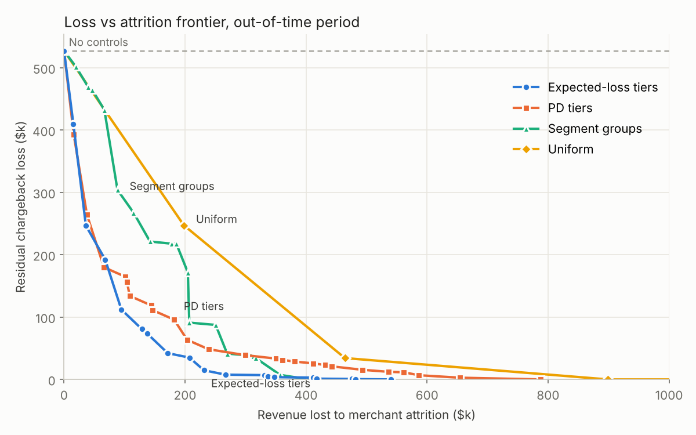

# Merchant Risk Tiering & Reserve Policy Engine


**How much merchant money should a payment platform hold back, and from whom?**

Payment platforms pay merchants before chargebacks arrive, sometimes months later. If a merchant fails in between, the platform absorbs the loss. Holding back funds (rolling reserves, delayed settlement) covers that loss, but merchants with cash tied up leave for competitors.

This project treats merchant risk as a credit problem: it scores merchants' probability of failure, estimates their exposure, and finds the reserve policy with the best trade-off between **chargeback loss** and **revenue lost to merchant attrition**.



*Each point is a reserve policy; lower-left is better. Each line is the efficient frontier for one way of grouping merchants. All results are on an out-of-time period the models never trained on.*

## Key findings

1. **Tier on expected loss, not just probability of failure.** Ranking merchants by expected loss per $ of volume (PD × exposure) beat ranking by PD alone across almost the whole frontier. Exposure depends heavily on delivery lag: a travel merchant selling tickets 60 days ahead carries far more risk per $ than a food delivery merchant with the same PD.
2. **Risk-based tiering more than halves the total cost.** The best expected-loss policy costs $207k (residual loss + lost revenue), against $445k for the best uniform policy and $527k with no controls.
3. **The recommendation is robust.** Across low, medium and high assumptions about merchant churn, the safest 70% of merchants get no controls and tier C a light reserve. Only the strength of controls on the riskiest tiers changes.

| Policy | Residual loss | Revenue lost | Total cost |
|---|---|---|---|
| No controls | $527k | $0 | $527k |
| **Expected-loss tiers** (A, B none; C, D light; E medium) | $112k | $95k | **$207k** |
| PD tiers, best policy | $134k | $109k | $243k |
| Segment groups (no model), best policy | $91k | $207k | $298k |
| Uniform, best policy | $247k | $198k | $445k |

## How it works

```
generate_data.py  →  features.py + risk_model.py  →  policy_engine.py
synthetic merchants,   point-in-time features,        reserve policies,
transactions and       PD models, A–E tiers,          loss vs attrition
chargebacks            expected loss                  frontier
```

**1. Synthetic data.** 5,000 merchants across seven segments over a year, with daily transactions and chargebacks. Each merchant has a hidden risk level the models never see. Failing merchants either "bust out" (volume ramps up before they disappear) or decline gradually. When a merchant fails, customers who paid but haven't received their goods file chargebacks, which is where most losses come from. Every parameter and its source is in [`assumptions.md`](assumptions.md).

**2. Risk tiering.** Merchants are scored at monthly snapshots on the probability of failing within 90 days, using only information available on the snapshot date.
- Two models, two jobs: a **WoE scorecard** (logistic regression) sets tiers A–E because it is transparent and explainable to merchants and auditors; a **gradient boosting** model acts as an early-warning overlay, flagging merchants the scorecard rates well but that look high-risk to the boosted model.
- Validated **out-of-time**, training only on snapshots whose 90-day outcome was fully observed before the test period, the same discipline as not modelling on immature vintages.
- Out-of-time AUC: 0.76 (scorecard), 0.81 (gradient boosting). The overlay flags 1.6% of tier A–C merchants; their failure rate is about 10× that of the rest.
- Expected loss = PD × EAD × LGD, with exposure estimated from sales run-rate and delivery lag.

Details: [`reports/risk_tiering.md`](reports/risk_tiering.md)

**3. Reserve policy engine.** Five control levels, from none to a 25% reserve held 180 days plus a 7-day settlement delay. When a merchant fails, the funds the platform still holds offset its chargebacks; locking up funds raises the chance the merchant leaves. All 126 tier-to-level assignments are evaluated for each grouping scheme.

Details: [`reports/policy_engine.md`](reports/policy_engine.md)

## Limitations

- **Synthetic data.** The models partly learn back the simulation's own structure. The point is the framework, from scores to tiers to policies to a measurable trade-off; with real data the same pipeline would be recalibrated.
- **Illustrative parameters.** Chargeback rates are checked against public benchmarks, but the churn response, take rate and share of undelivered customers who dispute have no public benchmark. The report tests churn sensitivity.
- **Small number of failures.** The out-of-time period has 94 failures (as merchant-snapshots) for model testing and 73 for policy evaluation, so differences between nearby tiers and policies are noisy.
- **Simplifications.** Reserves are assumed fully built up; churn reduces revenue but not losses (conservative, since some risky merchants would leave first); held funds are assumed fully usable against chargebacks.
- **Not modelled.** Refunds, merchants winning disputes back, third-party card fraud, transaction limits, multiple currencies.

## Next steps

- **Separate distress from bust-out.** The model predicts whether a merchant stops operating, not how. Gradual distress is credit risk; bust-out is closer to fraud and costs about 3× as much per failure. Next: estimate exposure separately for each, and add a daily volume-velocity rule that delays settlement as soon as volume spikes, instead of waiting for the monthly snapshot.
- **Link churn to the cash held.** Churn probability is a fixed number per control level today. It should rise with held funds as a share of the merchant's revenue, so reserve size and holding period affect both sides of the trade-off.
- **Model the reserve build-up period.** A new rolling reserve takes the full holding period to fill, so merchants who have just been placed under controls are under-protected.
- **Smaller fixes.** Remove the small overlap in the exposure formula, where undelivered sales are counted in both the non-delivery and normal-dispute terms; calibrate exposure by segment rather than with a single factor; recalibrate PD on recent data and track actual-to-expected by tier.

## Run it

```bash
pip install -r requirements.txt
python src/generate_data.py   # data/merchants.csv, daily.csv, chargebacks.csv
python src/risk_model.py      # data/scored_snapshots.csv, reports/risk_tiering.md
python src/policy_engine.py   # reports/policy_engine.md, reports/frontier.png
```

The pipeline takes under a minute and is fully reproducible from a fixed seed; no data is stored in the repo. CI reruns it on every change and checks the results still support the findings above (`tests/check_results.py`).

## Notes

- All data is synthetic. Nothing in this project uses data, rules, thresholds or model logic from any employer.
- Built with the help of an AI coding assistant. The problem framing, design choices and assumptions are mine, and I reviewed every change.
