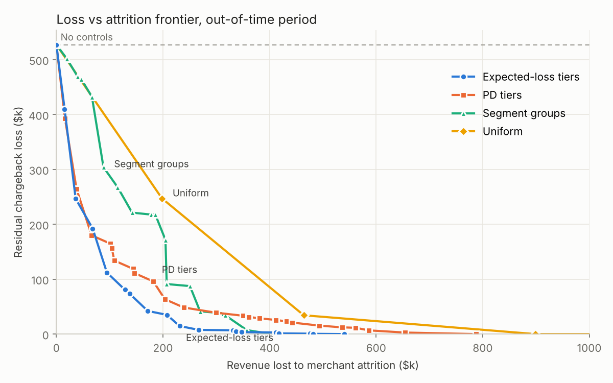

# Reserve policy engine results

Generated by `src/policy_engine.py`. All data is synthetic; every parameter is in `assumptions.md`.

## Setup

- Population: 4,839 merchants alive on day 240. Evaluation window: days 240–364, the out-of-time period the risk models never trained on.
- Failures in the window: 73; gross loss with no controls: $527,243.
- Tiers are read at day 240 and refreshed at day 270 for merchants still alive.
- Revenue lost = churn probability x merchant's run-rate volume over the window x 0.5% net take rate.

## Control levels

A rolling reserve withholds a share of each payout for a hold period; an extra settlement delay holds the whole payout for a few days. On the failure day, the platform keeps whatever merchant funds it still holds and uses them to cover chargebacks.

| level      | reserve_rate   |   hold_days |   extra_delay_days |   funds_locked_days_of_sales | churn_probability   |
|:-----------|:---------------|------------:|-------------------:|-----------------------------:|:--------------------|
| None       | 0%             |           0 |                  0 |                          0   | 0.0%                |
| Light      | 5%             |          90 |                  0 |                          4.5 | 5.8%                |
| Medium     | 10%            |          90 |                  2 |                         11   | 13.6%               |
| Heavy      | 15%            |         120 |                  5 |                         23   | 26.4%               |
| Very heavy | 25%            |         180 |                  7 |                         52   | 50.0%               |

## Policies compared

Each scheme assigns a control level to five ordered groups, with worse groups never getting lighter controls (126 combinations).

- **Expected-loss tiers**: merchants ranked by expected loss per $ of daily volume (PD × EAD ÷ run-rate), cut at the same population shares as the PD tiers. Reserves are a share of volume, so this is the risk that matters: it combines how likely a merchant is to fail with how much exposure each $ of its sales creates.
- **PD tiers**: the scorecard's A–E tiers, ranked on probability of failure only.
- **Segment groups**: a model-free benchmark. Segments are ranked by their loss rate before day 240 and split into five groups (food_delivery = A, digital_goods = A, retail_physical = B, electronics = C, subscription = C, travel = D, events_ticketing = E).
- **Uniform**: one level for everyone.

## Lowest total cost by scheme

Total cost = residual loss + revenue lost.

| scheme              | A     | B     | C      | D      | E      | residual_loss   | revenue_lost   | total_cost   |
|:--------------------|:------|:------|:-------|:-------|:-------|:----------------|:---------------|:-------------|
| No controls         | None  | None  | None   | None   | None   | $527,243        | $0             | $527,243     |
| Expected-loss tiers | None  | None  | Light  | Light  | Medium | $112,100        | $94,774        | $206,875     |
| PD tiers            | None  | None  | Light  | Light  | Medium | $133,975        | $108,580       | $242,555     |
| Segment groups      | None  | None  | Medium | Medium | Medium | $91,117         | $207,040       | $298,157     |
| Uniform             | Light | Light | Light  | Light  | Light  | $247,171        | $198,167       | $445,338     |

At the recommended policy's revenue cost ($94,774), the lowest residual loss each scheme can reach:

| scheme              | lowest_residual_loss   |
|:--------------------|:-----------------------|
| Expected-loss tiers | $112,100               |
| PD tiers            | $179,822               |
| Segment groups      | $304,020               |
| Uniform             | $527,243               |

## Recommended policy (expected-loss tiers)

Tier A: None, Tier B: None, Tier C: Light, Tier D: Light, Tier E: Medium.

- Residual loss $112,100 vs $527,243 with no controls (79% reduction).
- Revenue lost to attrition: $94,774.

Several neighbouring policies on the frontier have total costs within a few percent of this one, so the optimum is flat: the choice between them is a question of risk appetite rather than precision.

## Sensitivity to the churn assumption

Churn sensitivity is the least certain input. The recommended policy under lower and higher values:

|   churn_sensitivity | churn_at_light   | A    | B    | C     | D      | E      | residual_loss   | revenue_lost   |
|--------------------:|:-----------------|:-----|:-----|:------|:-------|:-------|:----------------|:---------------|
|                 0.2 | 3.0%             | None | None | Light | Medium | Heavy  | $42,091         | $89,999        |
|                 0.4 | 5.8%             | None | None | Light | Light  | Medium | $112,100        | $94,774        |
|                 0.8 | 11.3%            | None | None | Light | Light  | Medium | $112,100        | $181,199       |

## Efficient frontier (expected-loss tiers)

Policies that no other policy beats on both residual loss and revenue lost.

| A     | B      | C      | D      | E      | residual_loss   | revenue_lost   | total_cost   |
|:------|:-------|:-------|:-------|:-------|:----------------|:---------------|:-------------|
| None  | None   | None   | None   | None   | $527,243        | $0             | $527,243     |
| None  | None   | None   | None   | Light  | $409,841        | $15,454        | $425,296     |
| None  | None   | None   | None   | Medium | $246,610        | $36,202        | $282,812     |
| None  | None   | None   | Light  | Medium | $192,258        | $68,109        | $260,367     |
| None  | None   | Light  | Light  | Medium | $112,100        | $94,774        | $206,875     |
| None  | None   | Light  | Light  | Heavy  | $80,727         | $128,659       | $209,387     |
| None  | None   | Light  | Medium | Medium | $73,464         | $137,610       | $211,074     |
| None  | None   | Light  | Medium | Heavy  | $42,091         | $171,495       | $213,586     |
| None  | None   | Medium | Medium | Heavy  | $35,028         | $207,294       | $242,323     |
| None  | Light  | Light  | Medium | Heavy  | $14,685         | $231,210       | $245,895     |
| None  | Light  | Medium | Medium | Heavy  | $7,622          | $267,009       | $274,632     |
| Light | Light  | Medium | Medium | Heavy  | $6,868          | $331,434       | $338,303     |
| None  | Light  | Medium | Heavy  | Heavy  | $5,189          | $336,968       | $342,157     |
| None  | Medium | Medium | Medium | Heavy  | $3,649          | $347,179       | $350,828     |
| Light | Medium | Medium | Medium | Heavy  | $2,895          | $411,604       | $414,499     |
| None  | Medium | Medium | Heavy  | Heavy  | $1,216          | $417,138       | $418,353     |
| None  | Medium | Heavy  | Heavy  | Heavy  | $754            | $475,603       | $476,357     |
| Light | Medium | Medium | Heavy  | Heavy  | $462            | $481,562       | $482,024     |
| Light | Medium | Heavy  | Heavy  | Heavy  | $0              | $540,028       | $540,028     |

## Limitations

- Churn sensitivity and take rate are illustrative assumptions; the recommended policy moves if they change.
- Churn is applied only to revenue: the loss side assumes merchants stay long enough to fail. In practice some risky merchants would leave, which would lower losses further.
- Each merchant is assumed to have been under its tier's controls long enough for its reserve to be full.
- The window has only 73 failures, so differences between nearby policies are noisy.
